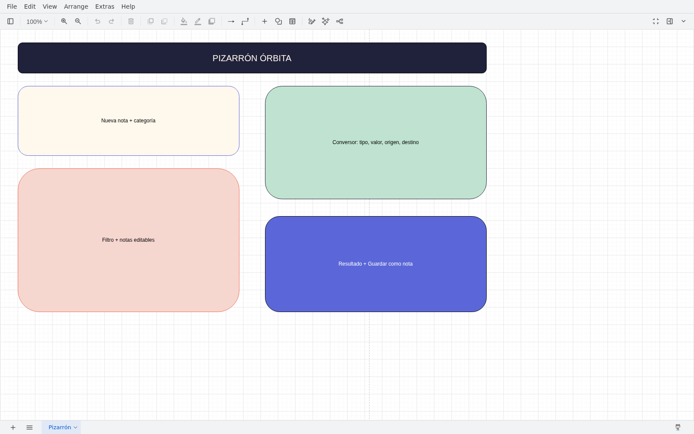
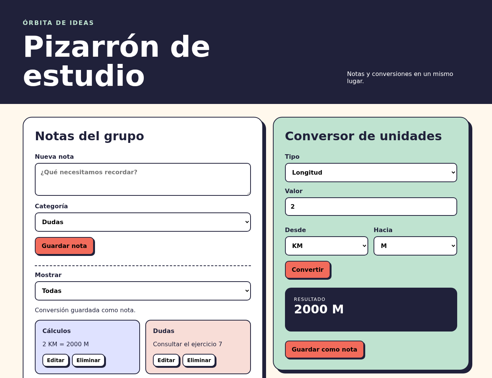

# Pizarrón de estudio — Órbita de Ideas

Aplicación de una sola pantalla que combina notas persistentes con un conversor de unidades.

## Datos generales

- Estudiante: Hodaia Yemal
- Tecnologías: HTML, CSS, JavaScript y localStorage
- Sketch local: [`evidencias/sketch-pizarron.png`](evidencias/sketch-pizarron.png)
- Documentación completa: [`documentacion.md`](documentacion.md)



## Funciones

- Crear, editar, eliminar y filtrar notas.
- Categorías Repasos, Dudas y Cálculos.
- Persistencia con `orbita-de-ideas:notas:v1`.
- Conversión de longitud, masa y temperatura.
- Control de cero absoluto y datos inválidos.
- Guardado de una conversión vigente como nota.
- Recuperación segura ante almacenamiento corrupto o bloqueado.

## Prompt utilizado

```text
Implementá el Pizarrón de estudio de Órbita de Ideas en index.html, style.css y script.js. En una pantalla incluí notas con categorías Repasos, Dudas y Cálculos, opciones para crear, editar y eliminar, filtro y localStorage con la clave orbita-de-ideas:notas:v1. Cada nota tiene id, texto y categoria. Sumá un conversor de longitud (m, km, cm), masa (g, kg) y temperatura (C, F, K), validando entradas y cero absoluto. Permití guardar una conversión vigente como nota y anulá el resultado cuando cambie cualquier entrada. Si localStorage está corrupto o bloqueado, avisá y mantené la aplicación usable. Usá los IDs del sketch, diseño responsive y mensajes accesibles.
```

## Pruebas

Se verificaron la creación, edición y eliminación de notas, filtros, recarga, datos corruptos, `2 km = 2000 m`, `1 kg = 1000 g`, `0 °C = 32 °F`, `0 °C = 273.15 K`, temperaturas imposibles e invalidación del resultado.

```bash
node --test tests/board.test.js
node --check script.js
```

## Evidencia



## Ejecución

Abrir `index.html` en el navegador. Los datos se guardan localmente.
