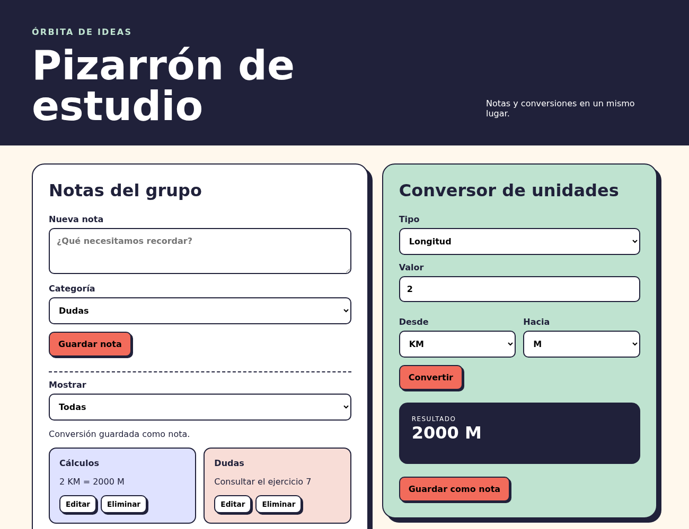

# Pizarrón de estudio — Órbita de Ideas

## Datos generales y sketch

- Estudiante: Hodaia Yemal
- Tecnologías: HTML, CSS, JavaScript y localStorage
- Repositorio: https://github.com/2023hodaiayemal-netizen/pizarron-de-estudio
- Sketch previo: `evidencias/sketch-pizarron.drawio` y `evidencias/sketch-pizarron.png`

## Planeamiento

Una sola pantalla combina notas y conversor. Las notas permiten alta, edición, eliminación, filtro y persistencia. Categorías: Repasos, Dudas y Cálculos. Se convierten longitud, masa y temperatura; un resultado vigente puede guardarse como nota.

## Prompt inicial

```text
Implementá el Pizarrón de estudio de Órbita de Ideas en index.html, style.css y script.js. En una pantalla incluí CRUD de notas con categorías Repasos, Dudas y Cálculos, filtro y localStorage con la clave orbita-de-ideas:notas:v1. Cada nota tiene id, texto y categoria. Sumá un conversor de longitud (m, km, cm), masa (g, kg) y temperatura (C, F, K), validando entradas y cero absoluto. Permití guardar una conversión vigente como nota y anulá el resultado cuando cambie cualquier entrada. Si localStorage está corrupto o bloqueado, avisá y mantené la aplicación usable. Usá los IDs del sketch, diseño responsive y mensajes accesibles.
```

## Pruebas y versiones

Se verificaron el 24/11/2026:

- Alta, edición, eliminación y filtro de notas.
- Persistencia tras recargar y recuperación segura ante JSON corrupto.
- Aviso no bloqueante cuando `localStorage` no está disponible.
- `2 km = 2000 m`, `1 kg = 1000 g`, `0 °C = 32 °F` y `0 °C = 273.15 K`.
- Rechazo de campos vacíos, valores no finitos y temperaturas bajo cero absoluto.
- Invalidación del resultado al cambiar valor o unidades.
- Guardado de `2 KM = 2000 M` como nota de Cálculos.
- Pruebas automatizadas y sintaxis con `node --test tests/board.test.js` y `node --check script.js`.

## Evidencia



## Estado

- [x] Sketch local
- [x] CRUD y filtros
- [x] Persistencia tolerante a errores
- [x] Tres tipos de conversión
- [x] Conversión guardada como nota
- [x] PDF local generado
